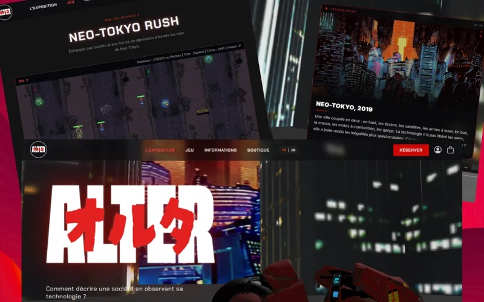
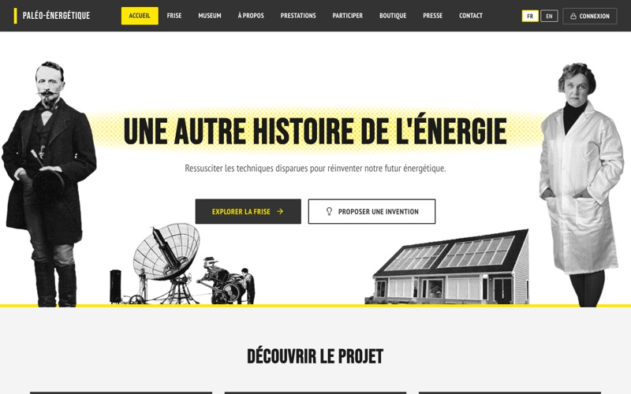
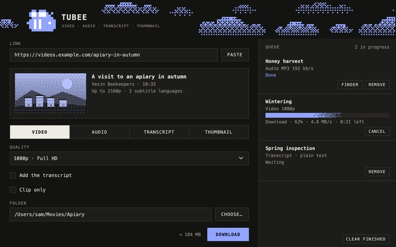
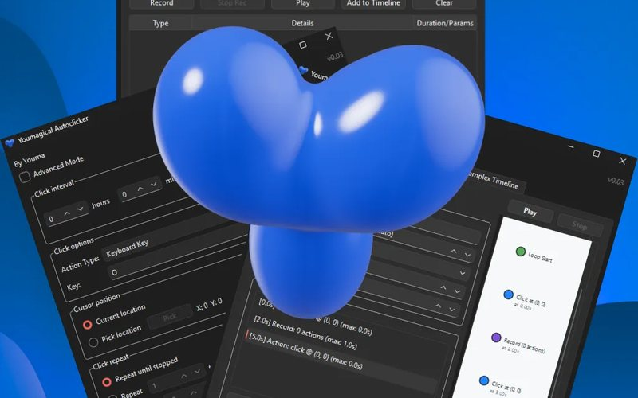

  
  
  

Web developer based in France, trained in multimedia and web development (BUT MMI) and Opquast-certified in web quality. The work here goes from full-stack web platforms in production to desktop apps, browser tools and small 3D games, mostly with React, TypeScript, Python and PHP.

## Selected work

<table>
  <tr>
    <td width="50%" valign="top">
      
      <h3>Alter</h3>
      
Website of an immersive exhibition on Akira: 3D virtual visit, ticketing, online shop and an embedded mini-game, in French and English.

      
<code>React&nbsp;18</code> <code>Three.js</code> <code>Spline</code> <code>GSAP</code> <code>PHP&nbsp;MVC</code> <code>MySQL</code>

      
<a href="https://alter-exposition.fr">Live site</a> · <a href="https://github.com/JomeiYouma/alter">Code</a>

    </td>
    <td width="50%" valign="top">
      
      <h3>Paléo-Énergétique</h3>
      
Multi-site platform for the association Atelier 21: one React and Express codebase serving a main site, themed sub-sites on their own domains, an interactive timeline, a map and a full back-office.

      
<code>React&nbsp;19</code> <code>Express</code> <code>MySQL</code> <code>Three.js</code> <code>Leaflet</code> <code>D3</code>

      
<a href="https://paleo-energetique.org">Live site</a> · <a href="https://github.com/JomeiYouma/Paleo-pedia">Code</a>

    </td>
  </tr>
  <tr>
    <td width="50%" valign="top">
      
      <h3>Tubee</h3>
      
Desktop app for macOS and Windows that saves a video, its audio track, its transcript or its thumbnail from a pasted link, with a website that handles accounts and the yearly subscription.

      
<code>Python</code> <code>PySide6</code> <code>yt-dlp</code> <code>Flask</code> <code>PostgreSQL</code>

      
<a href="https://tubee-phi.vercel.app">Website</a> · <a href="https://github.com/rmadore-1/tubee-releases/releases/latest">Downloads</a>

    </td>
    <td width="50%" valign="top">
      
      <h3>Youmagical Autoclicker</h3>
      
No-code automation tool for Windows: clicks and key presses on a timer in simple mode, recorded macros and a node-graph timeline editor in advanced mode, all driven by global hotkeys.

      
<code>Python</code> <code>Windows</code> <code>Automation</code>

      
<a href="https://github.com/JomeiYouma/Youmagical-Autoclicker">Download and guide</a>

    </td>
  </tr>
</table>

## More projects

- **[Pocket Deck Lab](https://github.com/JomeiYouma/pocket-deck-lab)**: scores Pokémon TCG Pocket decks from exact probabilities and Monte-Carlo simulation, with a deck builder and a versus mode. React, TypeScript.
- **[Parici](https://parici-murex.vercel.app)**: finds concerts, exhibitions and outings in Paris from the city's open data. React 19, TypeScript, TanStack Query. [Code](https://github.com/JomeiYouma/parici)
- **[Pixelate Studio](https://pixelate-studio-chi.vercel.app)**: pixelates an image on a grid and exports a transparent PNG, entirely in the browser. React, TypeScript, Canvas. [Code](https://github.com/JomeiYouma/pixelate-studio)
- **[QR Stylisé](https://jomeiyouma.github.io/qr-stylise-react/)**: styled QR code generator with presets, gradients and a logo, exported as PNG, SVG or JPG. React. [Code](https://github.com/JomeiYouma/qr-stylise-react)
- **Browser games**: [Cipher Breach](https://jomeiyouma.github.io/hangman/), a hangman reworked as a hacking terminal; [Speed Chaser](https://jomeiyouma.github.io/Speed-chaser/), an endless 3D runner with an online leaderboard; [Akira Shooter](https://jomeiyouma.github.io/Jeu-Shooter/), a configurable 2D shooter built as a React component.

## Stack

  

  

