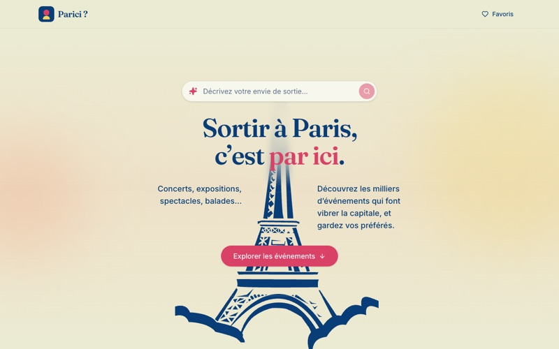
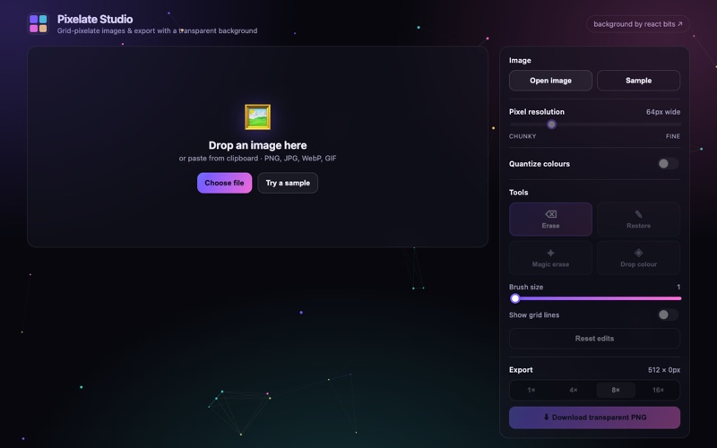
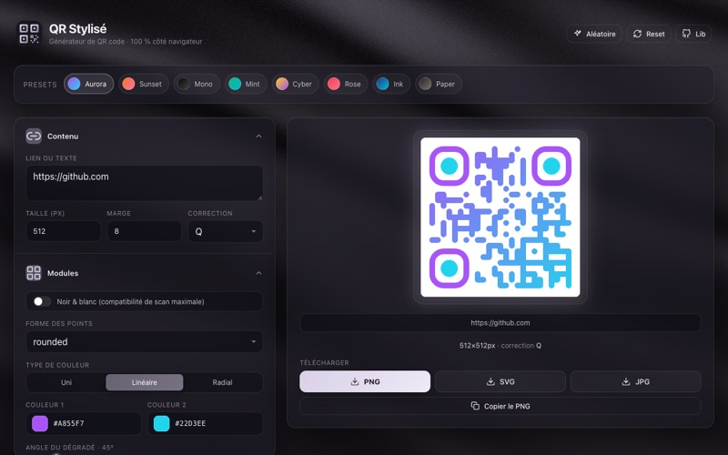
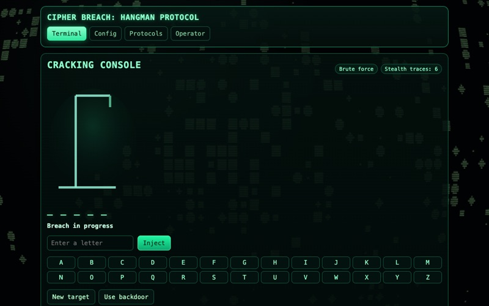

  
  
  

Web developer based in France, trained in multimedia and web development (BUT MMI) and Opquast-certified in web quality. The work here goes from a full-stack platform in production for an association to browser tools and small 3D games, mostly with React, TypeScript, Node and PHP.

## Selected work

<table>
  <tr>
    <td width="50%" valign="top">
      
      <h3>Paléo-Énergétique</h3>
      
Multi-site platform for the association Atelier 21: one React and Express codebase serving a main site, themed sub-sites on their own domains, an interactive timeline, a map and a full back-office.

      
<code>React&nbsp;19</code> <code>Express</code> <code>MySQL</code> <code>Three.js</code> <code>Leaflet</code> <code>D3</code>

      
<a href="https://paleo-energetique.org">Live site</a> · <a href="https://github.com/JomeiYouma/Paleo-pedia">Code</a>

    </td>
    <td width="50%" valign="top">
      
      <h3>Alter</h3>
      
Website of an immersive exhibition on Akira: 3D virtual visit, ticketing, online shop and an embedded mini-game, in French and English.

      
<code>React&nbsp;18</code> <code>Three.js</code> <code>Spline</code> <code>GSAP</code> <code>PHP&nbsp;MVC</code> <code>MySQL</code>

      
<a href="https://alter-exposition.fr">Live site</a> · <a href="https://github.com/JomeiYouma/alter">Code</a>

    </td>
  </tr>
  <tr>
    <td width="50%" valign="top">
      
      <h3>Parici</h3>
      
Single-page app to find concerts, exhibitions and outings in Paris from the city's open data. The URL holds the search state, favourites are stored locally, and the app is tested and linted in CI.

      
<code>React&nbsp;19</code> <code>TypeScript</code> <code>TanStack&nbsp;Query</code> <code>Tailwind&nbsp;v4</code> <code>Vitest</code>

      
<a href="https://parici-murex.vercel.app">Live site</a> · <a href="https://github.com/JomeiYouma/parici">Code</a>

    </td>
    <td width="50%" valign="top">
      
      <h3>Pixelate Studio</h3>
      
Image editor that pixelates a picture on a grid, lets you erase or restore cells, and exports a PNG with a transparent background. Everything runs in the browser.

      
<code>React&nbsp;18</code> <code>TypeScript</code> <code>Canvas</code> <code>Vite</code>

      
<a href="https://pixelate-studio-chi.vercel.app">Live site</a> · <a href="https://github.com/JomeiYouma/pixelate-studio">Code</a>

    </td>
  </tr>
  <tr>
    <td width="50%" valign="top">
      
      <h3>QR Stylisé</h3>
      
Styled QR code generator with presets, gradients, a drag-and-drop logo and PNG, SVG or JPG export, entirely client-side.

      
<code>React&nbsp;18</code> <code>qr-code-styling</code> <code>Three.js</code> <code>Vite</code>

      
<a href="https://jomeiyouma.github.io/qr-stylise-react/">Live site</a> · <a href="https://github.com/JomeiYouma/qr-stylise-react">Code</a>

    </td>
    <td width="50%" valign="top">
      
      <h3>Cipher Breach</h3>
      
Hangman reworked as a hacking terminal, with four game modes, a shader background and a draggable 3D operator badge.

      
<code>React&nbsp;19</code> <code>React&nbsp;Three&nbsp;Fiber</code> <code>Rapier</code> <code>OGL</code>

      
<a href="https://jomeiyouma.github.io/hangman/">Play</a> · <a href="https://github.com/JomeiYouma/hangman">Code</a>

    </td>
  </tr>
</table>

Two more games run in the browser: [Speed Chaser](https://jomeiyouma.github.io/Speed-chaser/), an endless 3D runner in Three.js with an online leaderboard, and [Akira Shooter](https://jomeiyouma.github.io/Jeu-Shooter/), a configurable 2D shooter built as a React component.

## Stack

  

  

